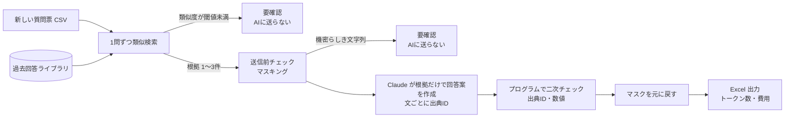

# rfp-answer-assistant

**An RFP/DDQ answer drafting assistant for asset managers: it retrieves the most similar past answers and lets Claude draft only from them.**

Every sentence must cite its source. Questions with no matching past answer, or that ask for figures, are flagged "要確認" (needs review). A program then checks that every number in the draft actually appears in the cited source.
It runs end to end without an API key (mock mode) and writes an Excel file with token usage and estimated cost. All data is fictional.

---

## 何を解決するか

年金基金や保険会社などの機関投資家は、運用会社を選ぶ・見直す際に審査質問票（RFP／DDQ）を送ってきます。項目は組織、運用プロセス、運用実績、リスク管理・コンプライアンス、IT・BCP、ESG、報酬などで、顧客が違っても聞かれることはほとんど同じです。

それでも現場では、営業担当が毎回過去の回答書を探し出し、コピーして手直しする作業を繰り返しています。時間がかかるうえ、古い数字をそのまま貼ってしまうリスクもあります。

このツールは、新しく届いた質問票の各問について、過去の回答ライブラリから似た回答を探し、**それだけを根拠に**回答案を作ります。根拠が見つからない質問や数値を問う質問は、AIに作文させずに「要確認」として人に回します。

> 架空の運用会社「Sakura Asset Management」と、その「日本株式バリュー戦略」を題材にしています。会社名・人名・数値はすべて架空です。

## 2分で試す

```bash
npm install
npm run demo
```

API キーは不要です（モックモード）。`output/rfp_answers.xlsx` ができます。

```
Q01  ✔ 下書き完了  根拠: A-001（類似度 0.35）
Q04  ⚠ 要確認    根拠: A-014（類似度 0.44）
      └ 数値を問う質問のため、最新の数値で要確認
Q07  ⚠ 要確認    根拠: A-028（類似度 0.51）
      └ 根拠にない数値（12）を検出
      └ 修正後の回答案: 事業継続計画（BCP）を策定し、…24時間以内に再開することを目標としています。[A-028]【要確認：根拠にない数値「12」を含む文を削除しました】
Q10  ⚠ 要確認    根拠: -
      └ 類似する過去回答なし：最高類似度 0.13（A-009） < 閾値 0.3
...
結果  下書き完了 7 / 要確認 7（AIに送信 11問、ライブラリ全体は送信していません）
トークン  入力 4,702 / 出力 880（概算）  推定費用  $0.0182（約2.7円）
```

`npm run demo` では、数値チェックが働くところを見せるために、Q07 だけモックがわざと根拠にない数字（「12時間」）を混ぜます。この文は二次チェックで削除され、Q07 は「要確認」になります。削除後の回答案は画面にも表示されるので、Excel を開かなくても確認できます。

### 出力される Excel

| 設問番号 | 質問 | 回答案 | 根拠 | ステータス |
|---|---|---|---|---|
| Q07 | 災害時の事業継続体制（BCP）について教えてください。 | 事業継続計画（BCP）を策定し、大阪にバックアップオフィスを確保しています。[A-028] 重要業務は災害発生から24時間以内に再開することを目標としています。[A-028] 【要確認：根拠にない数値「12」を含む文を削除しました】 | A-028（類似度 0.51）IT・BCP：事業継続計画（BCP）について教えてください。 | 要確認・根拠にない数値（12）を検出 |

「サマリー」シートには、設問数、要確認の件数、トークン数の合計、推定費用（USD・円）、使ったモデルと送信前チェックの種類が入ります。

## 役割分担：AI・プログラム・人

| 担当 | 任せること |
|---|---|
| AI（Claude） | 渡された根拠の文章を、質問に合わせて回答文にまとめる（文ごとに出典IDを付ける） |
| プログラム | 似た過去回答の検索、AIに送るかどうかの判断、機密情報のマスキング、出典IDと数値の検査、費用計算 |
| 人 | 「要確認」の問への回答、数値の最新化、最終的な承認 |

AIには文章をまとめる作業だけを任せ、正しさに関わる判断はプログラムと人が担います。

## 処理の流れ



1. **読み込み**：質問票 CSV（`question_id, question`）と回答ライブラリ CSV を読みます。
2. **検索**：文字バイグラムの TF-IDF とコサイン類似度で、似た過去回答を最大3件取り出します。どの文書にも出てくる戦略名や「教えてください」などは、ノイズになるので除いてから比べます。
3. **振り分け**：類似度が閾値（既定 0.30）に届かない問は、AIを呼ばずに「要確認」にします。
4. **送信前チェック**：AIに送るテキストは必ずガードレールを通します。顧客名・メールアドレス・電話番号などを記号に置き換え、APIキーやパスワードらしき文字列があれば送信自体を止めます。
5. **回答案の作成**：Claude に「根拠に書かれていることだけで書く」「文ごとに出典IDを付ける」「答えきれない部分は【要確認】と書く」と指示します。
6. **二次チェック**：返ってきた文章をプログラムで1文ずつ検査します（下記）。
7. **出力**：Excel と、実際にAIへ送った内容の記録（`output/sent_log.jsonl`）を残します。

## ハルシネーションを防ぐ仕組み

プロンプトで「根拠以外は書かないで」とお願いするだけでは、守られる保証はありません。そこで、**AIに任せない部分をプログラムで固める**方針にしています。

| 対策 | 内容 | 実装 |
|---|---|---|
| 根拠をたどれる | すべての文に出典ID（`[A-014]` など）を付けさせ、Excel の「根拠」列に類似度と元の質問を並べる。レビュー担当は元の回答とすぐ見比べられる | `prompt.ts`, `excel.ts` |
| 根拠がなければ書かせない | 類似度が閾値未満の問はAIを呼ばない。根拠が足りない部分はAIに「【要確認】」と書かせる | `pipeline.ts` |
| 数値を問う質問は人が確認 | 運用実績・残高・顧客数・報酬率などは、根拠があっても必ず「要確認」。ライブラリの値が古い可能性があるため | `rules.ts` |
| 出典IDの検査 | 出典IDのない文、渡していない根拠のIDを書いた文は削除して「要確認」 | `postcheck.ts` |
| 数値の二次チェック | 文中の数字が、**その文が引用している根拠**の中に実在するかを照合する。全角・半角や桁区切りのカンマの違いは揃えてから比べる。見つからなければその文を削除し「要確認」。AIが文に「【要確認】」と書き添えていても、この検査は省略しない | `postcheck.ts` |
| 途中で切れた回答の検出 | AIの回答が上限トークン数で切れた場合や、回答を拒否した場合は「要確認」にする | `llm.ts`, `pipeline.ts` |

数値チェックを「回答ライブラリ全体」ではなく「その文が引用した根拠」と照合しているのは、別の項目の数字をうっかり流用するミス（例：顧客数の「27」を別の質問の回答に書く）も拾うためです。

## セキュリティとコストへの配慮

- **送るのは必要な根拠だけ**：1問ごとに、検索でヒットした1〜3件だけを送ります。回答ライブラリ全体を送ることはありません。
- **送信前のガードレール**：同じ GitHub アカウントにある `ai-usage-guardrail` と連携できるようにしています。環境変数 `AI_USAGE_GUARDRAIL_MODULE` にアダプターのパスを指定すると、送信前に必ずそちらを通ります（サンプル：`adapters/ai-usage-guardrail.example.mjs`）。指定がなければ、内蔵の簡易マスキングを使います。
- **マスクは手元で戻す**：顧客名などは `[機密語_1]` のような記号にして送り、対応表は手元にだけ持ちます。返ってきた回答案の記号は、手元で元の語に戻します。
- **送信内容を記録**：実際に送ったテキスト（マスク後）を `output/sent_log.jsonl` に残し、後から何を外部に出したか確認できるようにしています。
- **APIキーはコードに書かない**：`.env` から読み込み、`.gitignore` で除外しています。
- **費用を毎回表示**：トークン数の合計と推定費用を、画面と Excel の両方に出します。単価と為替レートは環境変数で変えられます。根拠のない問はAIを呼ばないので、その分の費用もかかりません。モックモードの費用は、Sonnet の単価で文字数から概算した参考値です。
- **推論トークンを使わない**：根拠を並べ直すだけの作業なので、Claude の推論（thinking）は止めています（Sonnet 5.5 の場合。止められないモデルでは推論の深さを最小にします）。推論のトークンも出力トークンとして課金されるうえ、上限トークン数を使い切って回答が途中で切れる原因にもなるためです。

## 限界と今後の改善

- **検索精度**：文字バイグラムは辞書なしで手軽に使える反面、言い換え（「キーパーソン」と「運用責任者」など）には弱いです。`Retriever` インターフェースを切ってあるので、埋め込みベクトルによる検索に差し替えられます。
- **閾値の調整**：0.30 はこのサンプルデータで決めた値です。実データでは、正解付きの問を用意して適合率と再現率を見ながら決める必要があります。
- **数値チェックの範囲**：アラビア数字だけを対象にしています。漢数字（「三年」）や、「約6割」を「60％」と言い換えたケースは検出できません。
- **数字以外の誤り**：固有名詞や「しています／していません」の取り違えは、数値チェックでは拾えません。最終的な確認は人が行う前提です。
- **ライブラリの鮮度**：各回答に更新日を持たせていますが、古い回答を自動で除く仕組みはまだありません。更新日による警告を追加したいと考えています。
- **画面**：現状は CLI のみです。回答案を画面上で承認・修正し、承認済みの回答をライブラリに戻す流れを作ると、使うほど精度が上がる仕組みにできます。

## 動かし方

Node.js 20.12 以上が必要です。

```bash
git clone https://github.com/Eiennokoh/rfp-answer-assistant.git
cd rfp-answer-assistant
npm install

# モックモード（APIキー不要）
npm run demo

# 本番モード（Claude API を使う）
cp .env.example .env        # ANTHROPIC_API_KEY を記入
npm start

# 自分のファイルで動かす
npm start -- --questions path/to/rfp.csv --library path/to/library.csv --out output/result.xlsx

# テスト・型チェック
npm test
npm run typecheck
```

| 環境変数 | 内容 | 既定値 |
|---|---|---|
| `ANTHROPIC_API_KEY` | Claude API のキー。空ならモックモード | なし |
| `ANTHROPIC_MODEL` | 使うモデル | `claude-sonnet-5-5` |
| `SIMILARITY_THRESHOLD` | 根拠として使う類似度の下限 | `0.30` |
| `PRICE_INPUT_PER_MTOK` / `PRICE_OUTPUT_PER_MTOK` | 費用計算の単価（USD／100万トークン） | `src/cost.ts` の料金表 |
| `USD_JPY` | 円換算のレート | `150` |
| `AI_USAGE_GUARDRAIL_MODULE` | 外部ガードレールのアダプターのパス | なし（内蔵マスキング） |

## ファイル構成

```
data/
  answer_library.csv     過去回答ライブラリ（37件）
  new_rfp.csv            新しい質問票（14問。うち3問はライブラリにない話題）
  sensitive_terms.txt    送信前にマスクする固有名詞
src/
  cli.ts                 コマンドの入口
  pipeline.ts            1問ごとの処理の流れ
  retriever.ts           類似検索（文字バイグラム TF-IDF）
  rules.ts               数字を問う質問の判定
  guardrail.ts           送信前チェック（外部連携／内蔵マスキング）
  prompt.ts              AIへの指示
  llm.ts                 Claude API クライアントとモック
  postcheck.ts           出典IDと数値の二次チェック
  cost.ts                トークン数と費用の計算
  excel.ts               Excel 出力
test/                    自動テスト（node:test）
adapters/                ai-usage-guardrail 連携用アダプターのサンプル
```

## テスト

`npm test` で次のことを確かめています。

- ライブラリにない質問は「要確認」になり、AIは一度も呼ばれない
- 数字を問う質問は、根拠があっても「要確認」になる
- 根拠にない数字を含む文は削除され、正しい文は残る
- 別の根拠の数字を流用した文も検出される
- 出典IDのない文、渡していないIDを引用した文は削除される
- 「【要確認】」を書き添えた文でも、根拠にない数字は削除される
- AIの回答が途中で切れた場合は「要確認」になる
- AIに送られるのはヒットした根拠だけで、顧客名はマスクされている
- 送信前チェックで止まった問はAIに送られない

## ライセンス

MIT
